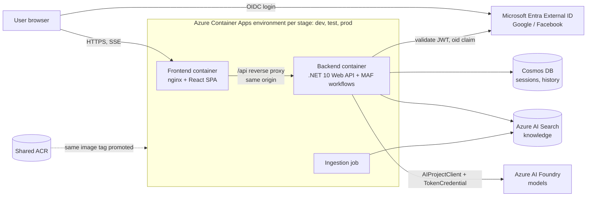

# Support assistant (agentic workflow chat)

A chat application where users sign in with a social account (Google, Facebook, ...) and talk to a multi-agent
workflow. The first workflow, **SupportTicket**, classifies a request as Policy, Claims or HealthAssessments and routes it
to a specialist agent that answers with citations from an Azure AI Search knowledge index. New workflow types can be added
without touching the chat endpoints or the chat UI.

## Architecture



- Agents are defined in code (`ChatClientAgent`), not as server-side Foundry agents.
- Cosmos and Search: access keys in Dev/Test, managed identity in Production (`Azure:AuthMode`); startup fails if
  `Key` is used in Production. Models always use a `TokenCredential`.
- User identity is the `oid` claim of the validated token; every data access is scoped to it.

## Repository layout

```
src/backend/      .NET 10 solution (SupportChat.slnx): Core, Infrastructure, Agents, Api, Ingestion + tests; Dockerfile(s)
src/frontend/     Vite + React + TypeScript SPA, nginx config, Dockerfile, Playwright e2e
infra/            Bicep (main.bicep, modules/, params/{dev,test,prod}.bicepparam, scripts/)
knowledge/        source documents for ingestion (policy, claims, health)
docs/             plan, API contract, data model, ADRs, auth and CI/CD setup
scripts/          setup-github-oidc.sh (one-time, run by the user)
.github/          workflows, dependabot
.claude/          agent and skill definitions for this repo
```

## Local development

Backend (details: [src/backend/README.md](src/backend/README.md)):
```bash
cd src/backend/src/SupportChat.Api
dotnet user-secrets set "Cosmos:Endpoint" "https://<account>.documents.azure.com:443/"
dotnet user-secrets set "Cosmos:Key" "<key>"          # Development uses Azure:AuthMode=Key
dotnet user-secrets set "Search:Endpoint" "..."; dotnet user-secrets set "Search:Key" "<query key>"
# plus AzureAd:* and Foundry:ProjectEndpoint, see the backend README
cd ../../../.. && dotnet run --project src/backend/src/SupportChat.Api   # http://localhost:5080
```
Secrets are never committed; use user-secrets or Key Vault references.

Frontend ([src/frontend/README.md](src/frontend/README.md)), Node version from `src/frontend/.nvmrc`:
```bash
cd src/frontend && npm ci && npm run dev    # http://localhost:5173, /api proxied to http://localhost:5080
```
Override the proxy target with `BACKEND_URL`. Runtime config comes from `/config.json` (`public/config.json` locally).

Cosmos emulator: `CosmosEmulatorTests` in `SupportChat.Infrastructure.Tests` run against the Azure Cosmos DB emulator and are
skipped unless it answers at `COSMOS_EMULATOR_ENDPOINT` (default `https://localhost:8081/`; key override
`COSMOS_EMULATOR_KEY`). Start the emulator, then `dotnet test src/backend`. CI has no emulator, so they are skipped there.

## Run locally without Azure

Design: [docs/adr/0005-local-mode.md](docs/adr/0005-local-mode.md). Prerequisites: .NET 10 SDK and Node 24 (no Azure account, no secrets).
```bash
node scripts/run-local.mjs        # backend http://localhost:5080, app http://localhost:5173
```
Open http://localhost:5173 and sign in as Alice or Bob (a local sign-in, not a real identity provider). Ctrl+C stops both.

- Chats live in memory and are lost when the backend restarts. Knowledge search is an in-memory keyword search over the
  repo `knowledge/` files (not Azure AI Search).
- Answers are scripted: no AI model is used and each answer says so. The classification, routing, tool call and citations
  run through the real workflow code.
- `--models foundry` uses a real Foundry project instead (user-secrets `Foundry:ProjectEndpoint` and the four
  `Workflows:SupportTicket:Agents:*:Deployment` names, `az login`). Your local chats and the retrieved knowledge text are then
  sent to that Foundry project.
- `--auth entra` uses real Entra External ID sign-in instead of the local one (user-secrets `AzureAd:*`); the script then starts the SPA
  with plain `npm run dev` (MSAL) instead of `dev:local`.
- The local backend only starts in Development, on loopback, outside containers and hosted environments; it is not part of any
  image or pipeline. The production API refuses `LocalMode:Enabled` in every environment.
- `npm run e2e:local` (Playwright against the real local backend) is manual only; CI does not run it.

## Tests

```bash
dotnet test src/backend                       # unit + API tests (fake auth, fake chat client, in-memory stores)
cd src/frontend && npm run lint && npm run typecheck && npm test
cd src/frontend && npx playwright install chromium && npm run e2e   # mocked auth + API; no real social login
```
Real social login is verified manually (not in the pipeline).

## Deploy flow

```
PR            -> ci (build/test, lint, e2e, bicep lint, docker build validation)
push to main  -> ci -> build + push support-{backend,frontend,ingestion}:<short-sha> to the shared ACR (once)
              -> deploy dev -> deploy test (approval) -> MI smoke job (--smoke-check) -> deploy prod (approval)
```
Same image tag is promoted through all stages. Azure authentication is OIDC (no stored Azure secrets). Infra changes go
through the manually dispatched `infra.yml` or are deployed from a laptop (no automatic infra runs; PRs get a Bicep lint). Setup and rollback: [docs/cicd-setup.md](docs/cicd-setup.md),
[infra/README.md](infra/README.md).

## Documentation

| Doc | Content |
|---|---|
| [docs/plan.md](docs/plan.md) | delivery plan, config keys, decisions |
| [docs/api-contract.md](docs/api-contract.md) | HTTP + SSE contract (change it first) |
| [docs/data-model.md](docs/data-model.md) | Cosmos data model |
| [docs/auth-setup.md](docs/auth-setup.md) | Entra External ID, Google, Facebook (manual) |
| [docs/cicd-setup.md](docs/cicd-setup.md) | GitHub Environments, OIDC, variables |
| [docs/adr/](docs/adr) | identity flow, workflow abstraction, Azure auth mode |
| [infra/README.md](infra/README.md) | Bicep modules, deploy order, pipeline roles |

## Adding a workflow type

Follow the checklist in [.claude/skills/add-workflow-type/SKILL.md](.claude/skills/add-workflow-type/SKILL.md): implement
the workflow definition and register it, add knowledge domains and ingestion, add routing tests with a fake chat client,
and confirm the UI dropdown shows it with zero frontend changes.
